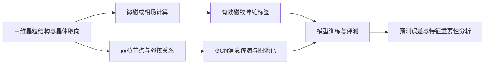
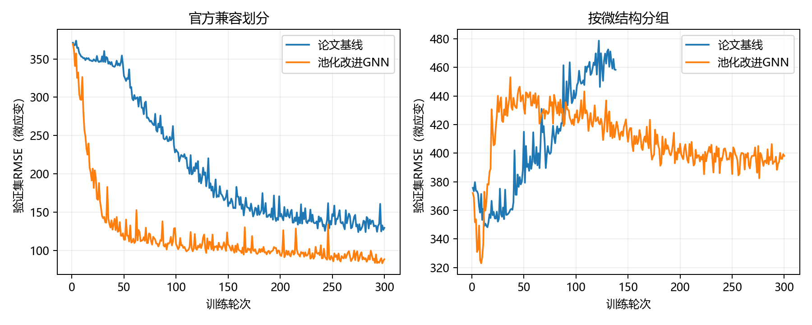

# 图神经网络在多晶材料磁致伸缩预测中的课程实践

本项目按照小组阶段汇报整理研究流程：从晶粒结构和晶体取向出发，理解磁化演化与磁致伸缩标签的来源，再通过图神经网络预测材料性能。仓库同时保留已经在本机 Anaconda 环境完成的公共数据集复现和改进实验。

目前采用阶段性课程项目的定位。汇报中展示的自建模拟结果，与仓库中实际运行的公共数据集结果分别记录。完整微磁/相场模拟器、小组自建训练数据和对应的积分梯度计算程序尚未导入本仓库。

[研究进度与汇报对应关系](docs/研究进度.md) · [物理原理和模型说明](docs/方法说明.md) · [自建数据衔接说明](docs/数据衔接.md) · [本机实验报告](REPORT.md) · [运行验证记录](VERIFICATION.md)

## 当前研究路线



阶段汇报展示了 `32×32×32` 小尺度晶粒结构、FFT 退磁场、Bunge 坐标变换、GCN 模型和结果分析。上述流程中的模拟标签生成仍需通过原始代码、参数和收敛记录进行完整验证。

| 环节 | 汇报展示的内容 | 本仓库可运行内容 |
|---|---|---|
| 晶粒结构 | 三维体素结构、二维切片、晶粒邻接图 | 公共数据集的节点和邻接矩阵读取 |
| 物理计算 | FFT退磁场、各向异性、坐标变换、LLG方程说明 | Bunge旋转及周期性FFT退磁场参考模块，通过解析检查 |
| 课程版GCN | 两层128通道GCN、均值池化、128→64→1回归层 | `course_model.py` 参考实现及训练/预测入口，完成接口检查 |
| 论文对照 | 多晶材料磁致伸缩预测 | 更正后的论文基线和池化改进，已完成首轮实验 |
| 可解释性 | 晶粒尺寸与取向的重要性、相关性图 | 上游IG源码保留；小组自建数据的IG程序和数值尚待导入 |

## 已完成的公共数据集实验

以下数值来自仓库的原始预测文件与实验记录，不是阶段汇报中的自建模拟结果。

| 方法 | 官方兼容划分的相对绝对误差 | 按微结构分组的相对绝对误差 |
|---|---:|---:|
| 更正后的论文基线 | 13.62% | 60.58% |
| 取向编码与池化改进GNN | 9.62% | 59.03% |
| 取向统计特征与树模型 | 8.03% | 26.24% |

官方兼容划分中，训练集与测试集共享185个微结构。分组划分的微结构重叠为零，衡量未见微结构的泛化。两种划分对应不同任务，分数不能直接混比。

首轮GNN训练上限为300轮，分组基线因验证误差长期无改善在138轮结束。仅使用一个随机种子，尚未完成论文推荐的1500轮和完整交叉验证。课程版GCN只完成接口检查，尚无正式训练成绩。树模型采用另一种训练方式，不能作相同计算预算的优劣声明。

汇报第25页图中标注的测试MARE为 **1.66%**，属于汇报提供的结果。它的原始数据、模型权重、划分和指标代码尚未导入，当前不能将它写成公共数据集的复现成绩。



## 使用Anaconda运行

本机已运行环境：Python 3.13.5、PyTorch 2.14.0+cpu、NumPy 2.5.3。下面的GNN代码只需要PyTorch和NumPy，无需安装 `torch_geometric`。`environment-port.yml` 记录当前版本，新建环境尚未单独验证。

```powershell
conda activate 你的PyTorch环境名
python download_data.py
python check_port.py
python check_course_modules.py
```

根据需要选择模型。`baseline` 是更正后的论文基线，`pooled` 是首轮池化改进，`course` 是按照阶段汇报结构整理的课程版GCN。

```powershell
# 课程版GCN：先做短训练，确认接口可用
python experiment.py --model course --split grouped --epochs 1 --seed 125

# 独立运行课程版正式实验，使用另一个随机种子以保留短训练记录
python experiment.py --model course --split grouped --epochs 300 --seed 126

# 重现首轮基线与池化模型的配置
./run_experiments.ps1 -Python 'C:\你的Anaconda目录\envs\你的环境名\python.exe' -Epochs 300

# 使用已训练的模型预测公共数据集中的一个微结构
python predict.py --run results/official_pooled_seed124 --structure 1 --field 200
```

课程版参考模型保留截图中的“两层GCN、均值池化、两层回归”结构。为支持同一微结构的不同磁场，训练入口额外把 `H/10000` 作为第六个节点特征；汇报截图没有展示磁场如何输入。设置 `CourseGNN(include_field=False)` 可以使用截图的五特征结构。此实现采用归一化邻接矩阵乘法，不是截图中PyTorch Geometric程序的逐字复制，初始化也不保证一致。

结果保存在 `results/划分_模型_seed随机种子/`。`metrics.json` 是汇总指标，`learning.csv` 是学习曲线，`predictions.csv` 是原始预测，`best.pt` 是验证集最佳权重。已有相同配置默认跳过；改变轮数前，应先归档旧结果，再明确使用 `--overwrite` 或脚本的 `-Overwrite`。`.running` 防止重复启动同一实验。

数据、缓存和模型权重保存在本地，通过下载和重新训练恢复。GitHub保留代码、指标、预测文件和图表。

## 统计特征对照与中文图表

这部分使用含NumPy、scikit-learn、joblib和Matplotlib的Anaconda环境。已运行的本机统计特征实验与绘图使用Anaconda基础环境，依赖不包含在GNN环境配置中。

```powershell
python descriptor_baseline.py
python summarize.py
python plot_results.py
```

统计特征包括取向的正弦/余弦统计量、体积加权特征、晶粒数量、尺寸与邻居数量统计。按验证集RMSE在极端随机树、随机森林和梯度提升回归之间选择，再评估测试集。这是没有消息传递层的替代基线。

CSV和JSON保留原有英文键，便于脚本读取；说明文档、运行提示和图表尽量使用中文。`summarize.py` 的正式报告针对随机种子124，其他种子的结果需要单独汇总。

## 文件入口

| 文件 | 作用 |
|---|---|
| `course_model.py` | 阶段汇报结构对应的课程版GCN |
| `physics_reference.py` | Bunge旋转、周期性FFT退磁场参考实现 |
| `check_course_modules.py` | 坐标变换、解析退磁场、池化性质检查 |
| `experiment.py` | 公共数据集训练、验证和测试 |
| `predict.py` | 已保存GNN模型的单结构预测 |
| `descriptor_baseline.py` | 统计特征与树模型对照 |
| `summarize.py` / `plot_results.py` | 中文结果汇总和图表 |
| `model.py` / `data.py` / `interpretation.py` | 作者原始源码，保留用于核对 |

## 参考文献与来源

Dai M., Demirel M. F., Liang Y., Hu J. **Graph neural networks for an accurate and interpretable prediction of the properties of polycrystalline materials**. *npj Computational Materials*, **7**, 103 (2021). [原论文](https://doi.org/10.1038/s41524-021-00574-w) · [2022年作者更正](https://doi.org/10.1038/s41524-022-00804-9) · [官方代码](https://github.com/mehmetfdemirel/PolycrystalGraph)

作者曾更正原代码中的消息传递错误。本项目以更正后的模型建立基线。上游版本为 `853719eb0ddaa7251881471a2b8524c060f830a3`，通过官方源码ZIP获取，保留 `README.upstream.md` 和MIT许可证。

公共数据包包含492个微结构、2410条原始观测，按官方规则剔除123条负值观测后保留2287条。小组自建模拟数据需要另外记录网格、材料参数、磁场单位和求解收敛标准，详见[数据衔接说明](docs/数据衔接.md)。

源码ZIP SHA256：`ac1f7f66e4f736627314776898867672df91321144578ca328c115d6ac06dc04`。

作者数据包 SHA256：`e54cbb9f818b7ca651071d08e58e66ac1f500cf60b3da912234f6a7fabaf3937`。

上游代码采用MIT许可证。数据集的再分发权限不由代码许可证推断，数据从作者提供的地址单独下载。
